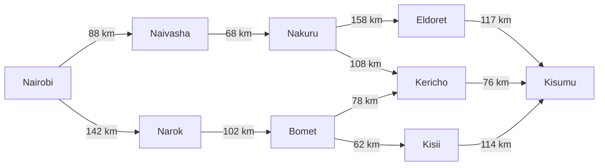
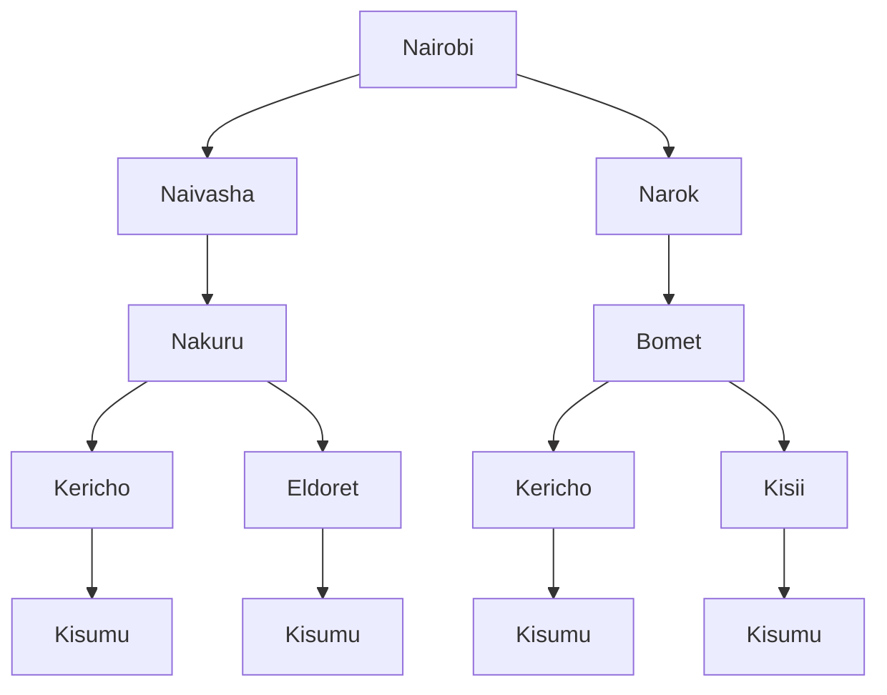

# ICS 3202: Artificial Intelligence
## Practical Exercise 3: Designing a Searching Agent

**Repository:** `PS-Agents`  
**File:** `design.md`  
**Agent:** Self-Driving Trailer Agent for Highway Cargo Transport  

---

## 1. Agent Specification & Environment Analysis

### 1.1 PEAS Framework

| Component | Description |
| :--- | :--- |
| **Performance Measure ($P$)** | • **Safety:** Zero collisions, full adherence to traffic regulations, speed limits, and right-of-way rules.<br>• **Efficiency:** Minimizing transit time and total distance traveled between source and destination.<br>• **Fuel/Energy Economy:** Optimizing engine load, momentum, and braking across steep road gradients.<br>• **Cargo Preservation:** Limiting lateral acceleration forces, sudden braking, and cargo shifting.<br>• **Schedule Adherence:** Punctual arrivals within designated delivery windows at destination depots. |
| **Environment ($E$)** | • Kenyan highway network (corridors A104, B1, B3, A1) featuring paved highways, escarpments, and diversions.<br>• Dynamic traffic: Matatus, commercial freight trucks, private cars, motorcycles (boda-bodas).<br>• Vulnerable road users: Pedestrians at market crossings and livestock herds.<br>• Variable weather and road terrain: Heavy downpours, high-altitude fog (e.g., Limuru, Mau Summit), speed bumps, and weighbridges. |
| **Actuators ($A$)** | • Steering column motor/actuator (lateral lane keeping and heading control).<br>• Electronic throttle controller (longitudinal acceleration).<br>• Pneumatic trailer foundation brakes and Anti-lock Braking System (ABS).<br>• Automated manual transmission (AMT) controller (gear shifting and engine retarder).<br>• Signaling systems: Turn signals, hazard indicators, headlights, and horn. |
| **Sensors ($S$)** | • Long-range forward LiDAR and 360° surround LiDAR units for 3D point-cloud mapping.<br>• Multi-camera computer vision array for lane boundary tracking, road sign detection, and object classification.<br>• Long- and medium-range RADAR units for velocity and distance tracking in fog/rain.<br>• Differential GPS receiver and Inertial Measurement Unit (IMU) for localization and vehicle attitude.<br>• Wheel speed sensors, axle weight strain gauges, and tire pressure monitoring system (TPMS). |

---

### 1.2 Five Environment Properties

1. **Partially Observable:**  
   The agent does not have complete access to the state of the entire road network at any instant. Sensor visibility is limited by physical barriers, blind bends, high-profile vehicles ahead, and environmental obstructions like highland fog.

2. **Stochastic:**  
   The subsequent state of the environment is not entirely determined by the agent's current state and actions. Unpredictable maneuvers of nearby motorists, sudden pedestrian crossings, and variable tire-road friction introduce non-deterministic outcomes.

3. **Sequential:**  
   Decisions made early directly influence subsequent options and vehicle states. Speed and lane choices impact momentum, brake heat dissipation, fuel usage, and the safety margin for following segments.

4. **Dynamic:**  
   The environment constantly changes while the agent is computing actions. Surrounding traffic, pedestrians, and obstacles move in real time; delaying deliberation leads to physical hazards.

5. **Continuous:**  
   The agent's state variables (velocity, heading angle, position coordinates) and actuator inputs (steering wheel angle, brake line pressure, throttle percentage) range over continuous, real-valued spaces.

*(Additionally, the operating environment is **Multi-agent**, involving both cooperative interactions like lane merging and competitive dynamics like queueing).*

---

## 2. Highway Network Modeling (Graph, Abstraction & Search Tree)

### 2.1 Concept of Abstraction
Operating an autonomous vehicle involves millisecond-level sensory processing and actuator signals. For strategic navigation, this physical complexity is abstracted:
* **State Abstraction:** The continuous physical landscape is abstracted into a discrete graph where vertices represent major transit towns, junctions, and regional hubs across Nairobi, Central Highlands, Rift Valley, and Lake Victoria Basin regions.
* **Action Abstraction:** Continuous trajectory execution is abstracted into atomic actions: "drive along highway segment $(u, v)$ from Town $u$ to Town $v$."
* **Path Cost Abstraction:** Variations in engine wear, gradient, and surface roughness are abstracted into the primary cost metric: total highway distance in kilometers ($km$).

---

### 2.2 Directed Graph Model

The directed graph below illustrates the primary highway arteries connecting Nairobi to Kisumu:

### 2.2 Directed Graph



### 2.3 Search Tree
The search tree abstracts the expansion of possible paths starting from the initial state (**Nairobi**) toward the goal state (**Kisumu**):


## 3. Path Cost Function & Optimal Path Determination

### 3.1 Path Cost Formulation
The path cost function $g(n)$ evaluates the total distance along a sequence of highway segments connecting the initial node ($S = \text{Nairobi}$) to the goal node ($G = \text{Kisumu}$):

$$g(n) = \sum_{(u, v) \in \text{Path}} d(u, v)$$

#### Segment Distance Matrix (Derived from Google Maps Highway Routes):
| Segment | Primary Route / Highway | Distance (km) |
| :--- | :--- | :--- |
| Nairobi -> Naivasha | A104 | 88 km |
| Naivasha -> Nakuru | A104 | 68 km |
| Nakuru -> Kericho | B1 | 108 km |
| Kericho -> Kisumu | B1 | 76 km |
| Nakuru -> Eldoret | A104 | 158 km |
| Eldoret -> Kisumu | C39 / A1 | 117 km |
| Nairobi -> Narok | B3 | 142 km |
| Narok -> Bomet | B3 | 102 km |
| Bomet -> Kericho | B7 | 78 km |
| Bomet -> Kisii | B3 | 62 km |
| Kisii -> Kisumu | A1 | 114 km |

---

### 3.2 Candidate Path Cost Evaluations

* **Route 1 (via Naivasha, Nakuru, Kericho):**  
  Nairobi -> Naivasha (88 km) -> Nakuru (68 km) -> Kericho (108 km) -> Kisumu (76 km)  
  $$g(\text{Route 1}) = 88 + 68 + 108 + 76 = \mathbf{340\text{ km}}$$

* **Route 2 (via Narok, Bomet, Kericho):**  
  Nairobi -> Narok (142 km) -> Bomet (102 km) -> Kericho (78 km) -> Kisumu (76 km)  
  $$g(\text{Route 2}) = 142 + 102 + 78 + 76 = \mathbf{398\text{ km}}$$

* **Route 3 (via Narok, Bomet, Kisii):**  
  Nairobi -> Narok (142 km) -> Bomet (102 km) -> Kisii (62 km) -> Kisumu (114 km)  
  $$g(\text{Route 3}) = 142 + 102 + 62 + 114 = \mathbf{420\text{ km}}$$

* **Route 4 (via Naivasha, Nakuru, Eldoret):**  
  Nairobi -> Naivasha (88 km) -> Nakuru (68 km) -> Eldoret (158 km) -> Kisumu (117 km)  
  $$g(\text{Route 4}) = 88 + 68 + 158 + 117 = \mathbf{431\text{ km}}$$

---

### 3.3 Programmatic Path Search Implementation (Uniform Cost Search)

```python
import heapq

def uniform_cost_search(graph, start, goal):
    """
    Finds the lowest-cost path between start and goal using Uniform Cost Search.
    """
    frontier = [(0, start, [start])]
    explored = set()

    while frontier:
        cost, current, path = heapq.heappop(frontier)

        if current in explored:
            continue
        explored.add(current)

        if current == goal:
            return cost, path

        for neighbor, distance in graph.get(current, []):
            if neighbor not in explored:
                heapq.heappush(frontier, (cost + distance, neighbor, path + [neighbor]))

    return float("inf"), []

# Highway network graph based on Google Maps distances
kenya_highway_graph = {
    "Nairobi": [("Naivasha", 88), ("Narok", 142)],
    "Naivasha": [("Nakuru", 68)],
    "Nakuru": [("Kericho", 108), ("Eldoret", 158)],
    "Narok": [("Bomet", 102)],
    "Bomet": [("Kericho", 78), ("Kisii", 62)],
    "Kericho": [("Kisumu", 76)],
    "Eldoret": [("Kisumu", 117)],
    "Kisii": [("Kisumu", 114)],
    "Kisumu": []
}

cost, path = uniform_cost_search(kenya_highway_graph, "Nairobi", "Kisumu")
print(f"Optimal Path: {' -> '.join(path)}")
print(f"Total Distance: {cost} km")
```

**Execution Output:**
```text
Optimal Path: Nairobi -> Naivasha -> Nakuru -> Kericho -> Kisumu
Total Distance: 340 km
```

---

### 3.4 Search Verdict
* **Optimal Route:** **Nairobi -> Naivasha -> Nakuru -> Kericho -> Kisumu**
* **Total Path Cost:** **340 km**


